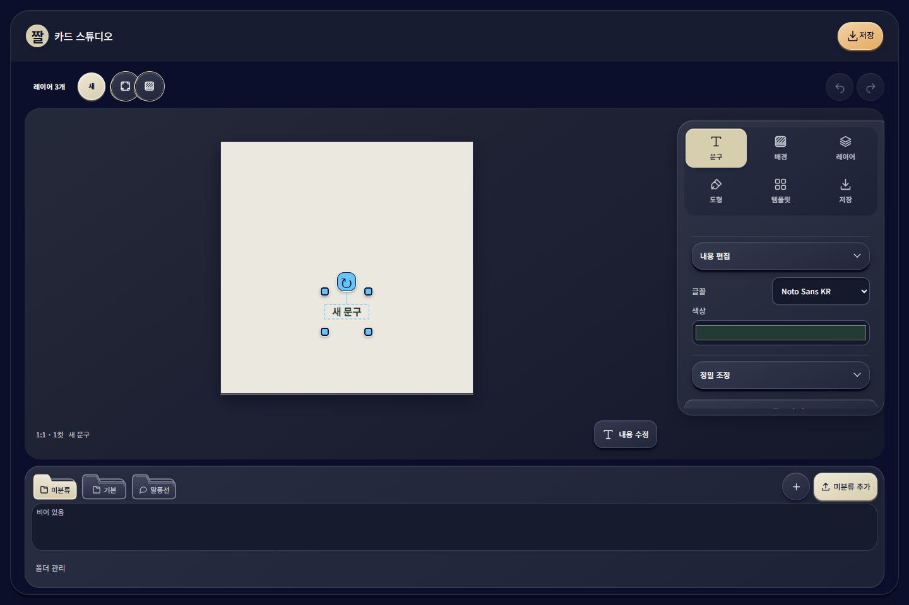
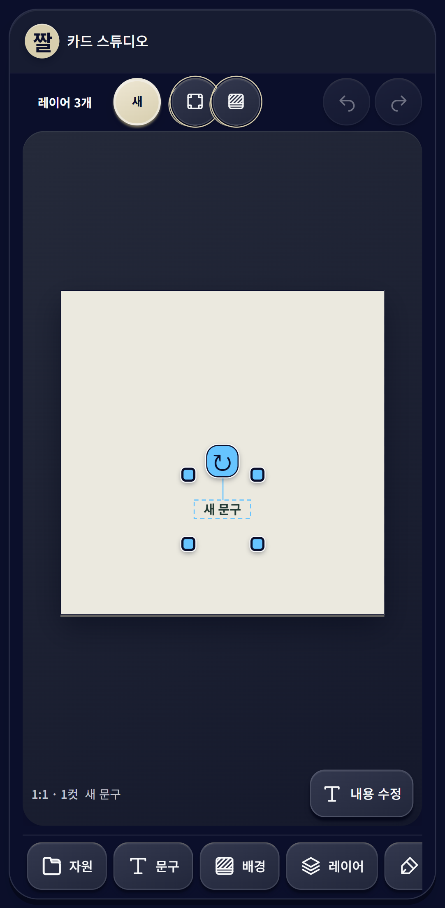

# 짤 카드 스튜디오

이미지·문구·말풍선·도형을 조합해 짤 카드를 만드는 브라우저 편집기다. PC에서는 마우스로, 모바일 브라우저에서는 터치로 편집하고, 템플릿을 브라우저에 저장하거나 이미지 파일로 내려받을 수 있다.

[편집기 열기](https://jjal-card-studio-three.vercel.app/) · [포트폴리오](docs/portfolio/overview.md) · [기술 문서](docs/README.md)

이 저장소는 `jkimsvsd-code`가 관리하는 공개 제출용 사본이다. 개발의 원본은 Private에 유지하고, 검토한 파일만 **Private → Public 한 방향**으로 내보낸다. 공개 저장소에서는 직접 수정·커밋·병합하지 않는다. 변경은 원본에서 검증한 뒤 다시 내보낸다. [관리 규칙](CONTRIBUTING.md)을 따른다.

## 화면

PC 편집 화면



모바일 편집 화면



## 구현한 기능

- 이미지와 여러 문구를 독립 레이어로 추가하고 이동·크기·회전·반전·순서를 편집한다.
- 정사각형·원·정삼각형·마름모를 추가한 뒤 가로·세로를 각각 조절한다.
- 말풍선의 문구·여백·꼬리·모서리·색·외곽선을 편집하고, PNG 말풍선을 변환해 재사용한다.
- 자원 폴더, 잠금·숨김·그룹·복제·컷 간 복사, 현재 세션의 실행 취소·다시 실행을 제공한다.
- 6종 기본 템플릿, 1·2·4컷, 8개 화면 비율과 로컬 글꼴 13종을 제공한다.
- 브라우저 템플릿 저장·불러오기·수정·삭제와 이미지를 포함한 JSON 내보내기·가져오기를 제공한다.
- 전체 카드·개별 컷을 PNG/JPG/WebP로 저장하고 투명 배경과 두 출력 해상도를 지원한다.

잘못된 입력은 검증 후 거부하며 기존 작업을 유지한다. 미리보기와 이미지 출력은 같은 Canvas 렌더러를 사용한다. 계정·서버 권한·공동 작업·AI 배경 제거·결제는 현재 구현 범위에 포함되지 않는다. 읽기 전용 화면은 UI 검토용이며 서버 접근 통제가 아니다.

## 구성

```text
apps/demo                 React 편집 화면과 브라우저 연결
packages/document-model   작품·템플릿 검증 스키마
packages/editor-core      불변 편집 명령·변형·세션 이력
packages/renderer         미리보기와 출력의 공통 Canvas 렌더링
packages/template-kit     템플릿 사본·JSON 백업
packages/persistence      IndexedDB 저장
packages/content          기본 소재·템플릿
packages/image-io          이미지 입력 검증·디코딩·출력
packages/policies         기본값과 제한
tests                     단위·브라우저 검사와 합성 입력
docs                      공개 설명·포트폴리오
```

Node 24 / npm 11 workspaces, React, TypeScript strict, Vite, Zod, idb, Canvas 2D, Vitest와 Playwright를 사용한다. 정확한 버전은 [package.json](package.json)과 [package-lock.json](package-lock.json)에 고정한다.

## 실행과 검사

Node 24.x와 npm 11.x가 필요하다. 저장소 루트에서 실행한다.

```sh
npm ci --ignore-scripts
npm run check
npm run dev
```

개발 화면은 `http://127.0.0.1:5173`에서 열린다. Windows PowerShell에서는 실행 정책에 따라 `npm` 대신 `npm.cmd`를 사용한다. `check`는 타입 검사·ESLint·단위 검사·정적 빌드를 실행하며 원격 업로드는 하지 않는다.

브라우저 검사에는 별도 Playwright 브라우저가 필요하다. [검사 안내](tests/README.md)에서 설치·실행·측정 범위를 확인한다.

## 검증 근거와 한계

2026-10-24 S01-27 원본 검증에서는 타입·lint·빌드와 **673개 단위 검사**, 최종 **유일 9개 브라우저 사례**를 확인했다. 실제 PNG **35개**의 편집 화면 대조에서 전체 RGBA **115,361,280채널 차이 0**이었다. 최초 브라우저 실행의 1개 실패는 새로고침 후 화면 준비를 기다리는 검사 조건을 보완해 별도로 통과했으며, 첫 실행 전체가 통과한 것으로 합산하지 않았다.

같은 날 공개 앱에서는 PC와 Pixel 7 브라우저 에뮬레이션의 **18단계**, 템플릿 저장·새로고침 뒤 복원, PNG **4개**의 픽셀 일치를 확인했다. 이 검사는 위의 9개 로컬 사례와 별도 실행이다. 공개 사본의 내보내기 검사와 원본 당시 결과도 서로 구분한다.

모바일 실물 기기·Safari·다른 OS·동시 사용 성능·제품 전체 인수 완료를 뜻하지 않는다. 저장 자료는 접속한 브라우저와 주소에 종속되므로 다른 주소로 옮길 때는 JSON 백업을 사용한다.

소재·글꼴의 원저자 고지와 이용 조건은 [THIRD-PARTY-NOTICES.md](THIRD-PARTY-NOTICES.md), 프로젝트 코드의 공개 범위는 [COPYRIGHT.md](COPYRIGHT.md)를 따른다.
